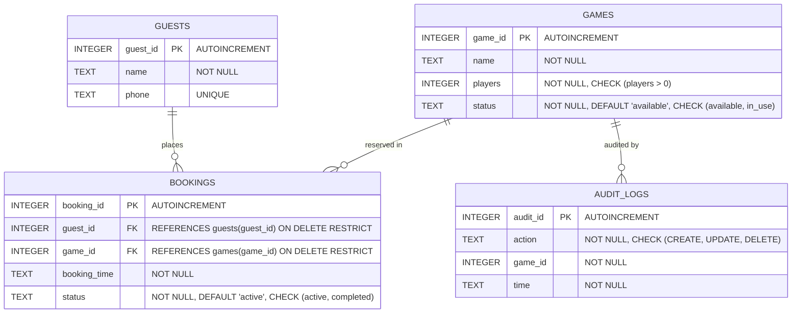

# YG-AIDE2B-G07
# BookNook Cafe – Board Game Booking Management System

BookNook Cafe is a backend-based Board Game Booking Management System developed using Node.js, Express.js, and SQLite. It manages cafe guests, board game shelf inventory, real-time availability states, game checkout and return bookings, player-count-based searching, relational multi-table reports, and an immutable transactional audit log of game catalog operations.

---

## Group Members Table

| S.No. | Member Name | Roll Number | Class | Assigned Role |
|---|---|---|---|---|
| 1 | Hema Charan | 252U1R5101 | YG-AIDE2B | Backend Server & Routing Developer |
| 2 | Sasidhar | 252U1R5130 | YG-AIDE2B | Database Designer & SQL Developer |
| 3 | Karunya Naidu | 252U1R5123 | YG-AIDE2B | REST API & CRUD Developer |
| 4 | Prem | 252U1R5124 | YG-AIDE2B | Validation & Search Developer |
| 5 | Lokesh Reddy | 252U1R5129 | YG-AIDE2B | Quality Analyst, Audit & Documentation Engineer |

---

## Team Members and Responsibilities

Each member was assigned distinct responsibilities according to their specialization, ensuring a clean division of work, modular design, and individual accountability.

### MEMBER 1 – HEMA CHARAN
**Role:** Backend Server & Routing Developer  
**Responsibilities:**
- Express.js server initialization, application configuration, and port binding.
- Environment variable configuration (`dotenv`) and Cloud deployment setup (`render.yaml`).
- Global middleware mounting (JSON request body parsing, URL-encoded parsing).
- Route mounting and strict URL routing precedence (`/bookings/details` before `/:id`).
- Graceful server shutdown handling for `SIGINT` and `SIGTERM` signals.

**Assigned files:**
- `server.js`
- `app.js`
- `routes/guestRoutes.js`
- `routes/gameRoutes.js`
- `routes/bookingRoutes.js`
- `routes/auditRoutes.js`
- `package.json`
- `.env.example`
- `render.yaml`

---

### MEMBER 2 – SASIDHAR
**Role:** Database Designer & SQL Developer  
**Responsibilities:**
- SQLite relational database schema design with 4 normalized tables (`guests`, `games`, `bookings`, `audit_logs`).
- Enforcing relational integrity via foreign key constraints (`PRAGMA foreign_keys = ON;`).
- Domain integrity rules (`CHECK (players > 0)`, `CHECK (status IN ('available', 'in_use'))`, `CHECK (status IN ('active', 'completed'))`).
- Database connection lifecycle management and automated directory and schema initialization.
- 3-Table SQL relational query design (`INNER JOIN` combining bookings, guests, and games).

**Assigned folder & files:**
- `database/`
  - `database/schema.sql` (Relational DDL schema with constraints)
  - `database/db.js` (Connection provider with foreign keys enabled)
  - `database/init.js` (Automated schema migration and table verification script)
  - `database/booknook.db` (SQLite binary database file)

---

### MEMBER 3 – KARUNYA NAIDU
**Role:** REST API & CRUD Developer  
**Responsibilities:**
- Complete CRUD operations for Guests (POST, GET all, GET by ID, PUT, DELETE).
- Complete CRUD operations for Board Games with catalog lifecycle management.
- Booking business logic: issuing games to guests and marking active bookings as completed.
- Atomic state transitions using SQLite transactions: synchronizing booking records with game shelf status (`available` $\leftrightarrow$ `in_use`).
- Multi-table report endpoint (`GET /bookings/details`) delivering human-readable guest and game data.

**Assigned folder:**
- `controllers/`
  - `controllers/guestController.js` (Guest management & unique phone handling)
  - `controllers/gameController.js` (Game catalog CRUD & player query filter)
  - `controllers/bookingController.js` (Atomic game issuing, completion & 3-table JOIN)

---

### MEMBER 4 – PREM
**Role:** Validation & Search Developer  
**Responsibilities:**
- Request body sanitization and strict type validation middleware.
- Validating positive integer identifiers (`:id`) and mandatory required fields.
- Player-capacity search filter validation (`GET /games?players=...`).
- Centralized 404 handler for non-existent routes.
- Centralized error-handling middleware intercepting SQLite constraint violations (`UNIQUE`, `FOREIGN KEY`, `CHECK`) without exposing SQL stack traces.

**Assigned folder:**
- `middleware/`
  - `middleware/validateGuest.js` (Guest creation, update, and ID validation)
  - `middleware/validateGame.js` (Game creation, update, ID, and player query validation)
  - `middleware/validateBooking.js` (Booking creation and ID validation)
  - `middleware/notFound.js` (Structured 404 Route Not Found handler)
  - `middleware/errorHandler.js` (Centralized SQLite and HTTP error mapper)

---

### MEMBER 5 – LOKESH REDDY
**Role:** Quality Analyst, Audit & Documentation Engineer  
**Responsibilities:**
- Implementing the Assignment Twist Rule: Transactional Game Audit Trail system.
- Designing and developing the `/audit` service, controller, and route for real-time history tracking.
- Authoring automated end-to-end integration test suites across all 4 resource modules.
- Authoring the comprehensive Postman collection (v2.1.0) with dynamic variable chaining and assertions.
- Creating project documentation, API reference guides, and deployment configurations.

**Assigned files & folders:**
- `services/auditService.js` (Audit trail insert & fetch logic)
- `controllers/auditController.js` (Audit endpoint controller)
- `tests/` (`runAllTests.js`, `guest.test.js`, `game.test.js`, `booking.test.js`, `audit.test.js`, `testHelper.js`)
- `postman/BookNook.postman_collection.json`
- `README.md`

---

## Problem Statement

Board game cafes offer customers a social dining experience centered around shared board game libraries. However, managing dozens of board games with different player capacities, tracking guest checkouts, and updating physical shelves manually presents serious operational problems:

1. **Untracked Game Checkouts**: Staff cannot immediately determine if a missing game is currently in use by a dining guest or lost.
2. **Double-Booking Risks**: Without concurrency guardrails, two staff members can accidentally assign the same physical game to different guests.
3. **Fragmented Records**: Guest details and game usage are recorded separately, requiring staff to manually reconcile who borrowed which game and at what time.
4. **Catalog Discrepancies**: Games are added, updated, or removed from circulation without any record of when or why changes occurred.
5. **Inefficient Guest Recommendations**: Staff cannot quickly filter which available games match a visiting group's party size (e.g., party of 4).

**BookNook Cafe** directly resolves these operational challenges by delivering an automated, transactionally safe, and audited REST API backend.

---

## Project Objectives

1. **Guest Registration**: Maintain verified records of cafe guests with unique telephone numbers and contact names.
2. **Game Catalog Management**: Track board game inventory with supported player limits and live availability states (`available` vs `in_use`).
3. **Double-Booking Prevention**: Guarantee that a board game cannot be issued to another guest while an active booking is in progress.
4. **Atomic Checkout & Return Workflow**: Guarantee that game shelf availability and booking states update synchronously inside SQLite database transactions.
5. **Relational Transparency**: Expose a 3-table SQL `INNER JOIN` endpoint (`/bookings/details`) combining bookings, guest names, game names, and timestamps in a single call.
6. **Player Count Filtering**: Enable cafe staff to filter games dynamically based on player count query parameters (`GET /games?players=4`).
7. **Transactional Audit Trail (Twist Rule)**: Maintain an immutable chronological audit trail logging `CREATE`, `UPDATE`, and `DELETE` operations on board games, exposing recent activity via `GET /audit`.
8. **Automated Verification**: Provide an automated integration test suite and an end-to-end Postman collection to verify all functional requirements and edge cases.

---

## Technologies Used

- **Runtime Environment:** [Node.js](https://nodejs.org/) (v20+ / LTS; tested on v22.23.1)
- **Web Framework:** [Express.js](https://expressjs.com/) (v5.3.0) — Modern REST API routing and middleware
- **Database Engine:** [SQLite](https://www.sqlite.org/) via [`better-sqlite3`](https://github.com/WiseLibs/better-sqlite3) (v13.1.1) — Fast, synchronous, file-based relational database with native foreign key support
- **Environment Management:** [`dotenv`](https://github.com/motdotla/dotenv) (v18.0.10)
- **Development Tooling:** [`nodemon`](https://nodemon.io/) (v3.1.14)
- **API Testing & Verification:** [Postman](https://www.postman.com/) — Multi-folder sequential collection runner with dynamic test assertions
- **Version Control:** Git & GitHub (Feature branch workflow with peer-reviewed Pull Requests)
- **Cloud Deployment:** [Render](https://render.com/) (Web Service with `render.yaml` specification)

---

## Existing Project Folder Structure

The project strictly follows a modular, layered MVC architecture:

```text
BookNook_Cafe-YG-AIDE2B-G07/
│
├── controllers/
│   ├── auditController.js             # Audit trail history retrieval controller
│   ├── bookingController.js           # Booking CRUD, atomic transitions, and 3-table JOIN
│   ├── gameController.js              # Game catalog CRUD and players query filtering
│   └── guestController.js             # Guest registration, unique phone, and CRUD logic
│
├── database/
│   ├── booknook.db                    # Local SQLite binary database file (git-ignored)
│   ├── db.js                          # SQLite database connection & PRAGMA foreign_keys = ON
│   ├── init.js                        # Schema auto-migration & table verification script
│   └── schema.sql                     # SQLite 4-table relational DDL schema definition
│
├── middleware/
│   ├── errorHandler.js                # Centralized SQLite constraint & HTTP error handler
│   ├── notFound.js                    # 404 Route Not Found handler
│   ├── validateBooking.js             # Booking payload and booking ID sanitizers
│   ├── validateGame.js                # Game payload, game ID, and players query validators
│   └── validateGuest.js               # Guest payload, phone uniqueness, and ID sanitizers
│
├── postman/
│   └── BookNook.postman_collection.json # 24-endpoint Postman collection v2.1.0
│
├── routes/
│   ├── auditRoutes.js                 # /audit route for retrieving recent audit history
│   ├── bookingRoutes.js               # /bookings routes (/details placed before /:id)
│   ├── gameRoutes.js                  # /games routes with validation middleware
│   └── guestRoutes.js                 # /guests routes with validation middleware
│
├── services/
│   └── auditService.js                # Transactional audit logging service (Twist Rule)
│
├── tests/
│   ├── audit.test.js                  # Audit log ordering, persistence, and limit tests
│   ├── booking.test.js                # Booking lifecycle, atomic state, and JOIN tests
│   ├── game.test.js                   # Game CRUD, constraint validation, and player search tests
│   ├── guest.test.js                  # Guest CRUD, duplicate phone, and sanitization tests
│   ├── runAllTests.js                 # Master test orchestrator executing all suites
│   └── testHelper.js                  # Test database isolation and cleanup utility
│
├── .env.example                       # Environment variable configuration template
├── .gitignore                         # Git exclusion rules (node_modules, .env, *.db)
├── app.js                             # Express application configuration and route binding
├── package-lock.json                  # Dependency tree lockfile
├── package.json                       # Project manifest, scripts, and engine specifications
├── README.md                          # Master project documentation (this document)
├── render.yaml                        # Infrastructure-as-Code for Render Cloud deployment
└── server.js                          # Application startup, database init, and graceful shutdown
```

---

## Database Design

The relational database (`database/booknook.db`) consists of **four interrelated tables** defined in `database/schema.sql`.

Foreign key integrity is enforced on every database connection via `PRAGMA foreign_keys = ON;`.



### Table Definitions

#### 1. `guests`
| Column | Type | Constraints | Description |
|---|---|---|---|
| `guest_id` | `INTEGER` | `PRIMARY KEY AUTOINCREMENT` | Unique identifier for cafe guest |
| `name` | `TEXT` | `NOT NULL` | Guest's full name |
| `phone` | `TEXT` | `UNIQUE` | Unique phone number for contact and identification |

#### 2. `games`
| Column | Type | Constraints | Description |
|---|---|---|---|
| `game_id` | `INTEGER` | `PRIMARY KEY AUTOINCREMENT` | Unique identifier for board game |
| `name` | `TEXT` | `NOT NULL` | Name of the board game |
| `players` | `INTEGER` | `NOT NULL, CHECK (players > 0)` | Maximum supported player capacity |
| `status` | `TEXT` | `NOT NULL DEFAULT 'available' CHECK (status IN ('available', 'in_use'))` | Current shelf availability state |

#### 3. `bookings`
| Column | Type | Constraints | Description |
|---|---|---|---|
| `booking_id` | `INTEGER` | `PRIMARY KEY AUTOINCREMENT` | Unique identifier for booking record |
| `guest_id` | `INTEGER` | `NOT NULL, FOREIGN KEY REFERENCES guests(guest_id) ON DELETE RESTRICT` | Guest borrowing the game |
| `game_id` | `INTEGER` | `NOT NULL, FOREIGN KEY REFERENCES games(game_id) ON DELETE RESTRICT` | Board game being played |
| `booking_time` | `TEXT` | `NOT NULL` | ISO 8601 timestamp when booking was created |
| `status` | `TEXT` | `NOT NULL DEFAULT 'active' CHECK (status IN ('active', 'completed'))` | Active checkout or completed return |

#### 4. `audit_logs` (Twist Rule Table)
| Column | Type | Constraints | Description |
|---|---|---|---|
| `audit_id` | `INTEGER` | `PRIMARY KEY AUTOINCREMENT` | Unique identifier for audit log entry |
| `action` | `TEXT` | `NOT NULL CHECK (action IN ('CREATE', 'UPDATE', 'DELETE'))` | Operation performed on game |
| `game_id` | `INTEGER` | `NOT NULL` | Identifier of affected game (retained even after deletion) |
| `time` | `TEXT` | `NOT NULL` | ISO 8601 timestamp of operation |

### Relational Safeguards
- **Orphan Prevention (`ON DELETE RESTRICT`)**: Prevents deleting a guest or game that is referenced by active or historic bookings (`409 Conflict`).
- **Double-Booking Prevention**: A game whose `status = 'in_use'` cannot be booked. The system rejects the attempt with `409 Conflict`.
- **Atomic Transactions**: Booking creation and game status updates run within an atomic `db.transaction()` block. If either statement fails, the entire transaction rolls back.
- **Permanent Audit Retention**: `audit_logs` deliberately does not cascade-delete records when a game is deleted, ensuring a permanent historical audit trail for administrative compliance.

---

## Main Features

1. **Guest Registration & Uniqueness Enforcement**: Complete CRUD operations for cafe guests with unique telephone index enforcement and trimming.
2. **Board Game Inventory Management**: Add, view, update, and remove games from shelves with positive player limits.
3. **Double-Booking Guardrails**: Prevents checking out an already borrowed game.
4. **Atomic Booking & Return Workflow**:
   - Booking a game changes its shelf status from `available` to `in_use` atomically.
   - Completing a booking (`PUT /bookings/:id/complete`) timestamps the return and restores the game to `available`.
5. **3-Table SQL INNER JOIN (`GET /bookings/details`)**: Combines `bookings`, `guests`, and `games` into a unified report showing guest names, phone numbers, game titles, player capacities, and booking status.
6. **Dynamic Player Capacity Search (`GET /games?players=4`)**: Allows cafe staff to filter games that support the exact number of players in a dining party.
7. **Transactional Audit Trail (Twist Rule)**: Automatically logs `CREATE`, `UPDATE`, and `DELETE` events for every game catalog operation.
8. **Recent Audit History (`GET /audit`)**: Exposes the 10 most recent audit records in descending chronological order.
9. **Centralized Error Handling**: Transforms database constraints (`UNIQUE`, `CHECK`, `FOREIGN KEY`) and invalid payloads into structured JSON error responses with standard HTTP status codes (`400`, `404`, `409`, `500`).

---

## API Endpoints

All endpoints consume and produce `application/json`.

| Category | Method | Endpoint | Description | Status Codes |
|---|---|---|---|---|
| **Root / Health** | `GET` | `/` | API status and endpoint directory | `200` |
| **Guests** | `GET` | `/guests` | Retrieve all registered guests | `200` |
| | `GET` | `/guests/:id` | Retrieve single guest by ID | `200`, `400`, `404` |
| | `POST` | `/guests` | Register a new cafe guest | `201`, `400`, `409` |
| | `PUT` | `/guests/:id` | Update guest name or phone | `200`, `400`, `404`, `409` |
| | `DELETE` | `/guests/:id` | Delete guest (blocked if referenced in bookings) | `200`, `400`, `404`, `409` |
| **Games** | `GET` | `/games` | Retrieve all games | `200` |
| | `GET` | `/games/:id` | Retrieve single game by ID | `200`, `400`, `404` |
| | `POST` | `/games` | Add new game to catalog (logs `CREATE` audit) | `201`, `400` |
| | `PUT` | `/games/:id` | Update game details or status (logs `UPDATE` audit) | `200`, `400`, `404` |
| | `DELETE` | `/games/:id` | Delete game (logs `DELETE` audit; blocked if in bookings) | `200`, `400`, `404`, `409` |
| **Games Search** | `GET` | `/games?players=4` | Filter board games by player capacity | `200`, `400` |
| **Bookings** | `GET` | `/bookings` | Retrieve all booking records | `200` |
| | `POST` | `/bookings` | Issue game to guest (transactional; sets `in_use`) | `201`, `400`, `404`, `409` |
| | `PUT` | `/bookings/:id/complete` | Return game (transactional; restores `available`) | `200`, `400`, `404`, `409` |
| **Booking JOIN** | `GET` | `/bookings/details` | Multi-table report via 3-table SQL `INNER JOIN` | `200` |
| **Audit Trail** | `GET` | `/audit` | Retrieve 10 most recent game audit logs | `200` |

### Endpoint Examples

#### 1. Root / Overview — `GET /`
- **Response (`200 OK`)**:
```json
{
  "success": true,
  "message": "Welcome to BookNook Cafe API - Board Game Booking Management System",
  "version": "1.0.0",
  "endpoints": {
    "guests": "/guests",
    "games": "/games",
    "bookings": "/bookings",
    "bookingDetails": "/bookings/details",
    "audit": "/audit"
  }
}
```

#### 2. Register Guest — `POST /guests`
- **Request Body**:
```json
{
  "name": "Arjun Sharma",
  "phone": "+91-9876543210"
}
```
- **Response (`201 Created`)**:
```json
{
  "success": true,
  "message": "Guest created successfully.",
  "data": {
    "guest_id": 1,
    "name": "Arjun Sharma",
    "phone": "+91-9876543210"
  }
}
```

#### 3. Add Board Game — `POST /games`
- **Request Body**:
```json
{
  "name": "Catan",
  "players": 4
}
```
- **Response (`201 Created`)**:
```json
{
  "success": true,
  "message": "Game added to catalog successfully.",
  "data": {
    "game_id": 1,
    "name": "Catan",
    "players": 4,
    "status": "available"
  }
}
```

#### 4. Search Games by Players — `GET /games?players=4`
- **Response (`200 OK`)**:
```json
{
  "success": true,
  "message": "Games matching filter retrieved successfully.",
  "count": 2,
  "data": [
    {
      "game_id": 1,
      "name": "Catan",
      "players": 4,
      "status": "available"
    },
    {
      "game_id": 3,
      "name": "Ticket to Ride",
      "players": 4,
      "status": "available"
    }
  ]
}
```

#### 5. Issue Game (Create Booking) — `POST /bookings`
- **Request Body**:
```json
{
  "guest_id": 1,
  "game_id": 1
}
```
- **Response (`201 Created`)**:
```json
{
  "success": true,
  "message": "Booking created successfully. Game is now in use.",
  "data": {
    "booking_id": 1,
    "guest_id": 1,
    "game_id": 1,
    "booking_time": "2026-11-14T12:00:00.000Z",
    "status": "active"
  }
}
```

#### 6. Complete Booking (Return Game) — `PUT /bookings/1/complete`
- **Response (`200 OK`)**:
```json
{
  "success": true,
  "message": "Booking completed successfully. Game returned to available shelf.",
  "data": {
    "booking_id": 1,
    "guest_id": 1,
    "game_id": 1,
    "booking_time": "2026-11-14T12:00:00.000Z",
    "status": "completed"
  }
}
```

#### 7. 3-Table SQL INNER JOIN — `GET /bookings/details`
- **Purpose**: Combines bookings, guest contact information, and board game catalog data in a single SQL query.
- **SQL Query**:
```sql
SELECT 
    b.booking_id,
    b.booking_time,
    b.status AS booking_status,
    g.guest_id,
    g.name AS guest_name,
    g.phone AS guest_phone,
    gm.game_id,
    gm.name AS game_name,
    gm.players AS game_players,
    gm.status AS game_status
FROM bookings b
INNER JOIN guests g ON b.guest_id = g.guest_id
INNER JOIN games gm ON b.game_id = gm.game_id
ORDER BY b.booking_id DESC;
```
- **Response (`200 OK`)**:
```json
{
  "success": true,
  "message": "Detailed booking records retrieved successfully.",
  "count": 1,
  "data": [
    {
      "booking_id": 1,
      "booking_time": "2026-11-14T12:00:00.000Z",
      "booking_status": "completed",
      "guest_id": 1,
      "guest_name": "Arjun Sharma",
      "guest_phone": "+91-9876543210",
      "game_id": 1,
      "game_name": "Catan",
      "game_players": 4,
      "game_status": "available"
    }
  ]
}
```

#### 8. Audit History (Twist Rule) — `GET /audit`
- **Response (`200 OK`)**:
```json
{
  "success": true,
  "message": "Recent audit records retrieved successfully.",
  "count": 3,
  "data": [
    {
      "audit_id": 3,
      "action": "UPDATE",
      "game_id": 1,
      "time": "2026-11-14T12:05:00.000Z"
    },
    {
      "audit_id": 2,
      "action": "CREATE",
      "game_id": 2,
      "time": "2026-11-14T11:45:00.000Z"
    },
    {
      "audit_id": 1,
      "action": "CREATE",
      "game_id": 1,
      "time": "2026-11-14T11:30:00.000Z"
    }
  ]
}
```

---

## Screenshots

Evidence of execution from the running application, endpoints, and automated tests:

### 1. Project Folder Structure in IDE


### 2. Server Startup in Terminal


### 3. Root API Response


### 4. Guests API Response


### 5. Games API Response


### 6. Games Search by Player Count Response


### 7. Bookings API Response


### 8. Booking Details API Response (3-Table SQL JOIN)


### 9. Audit Trail History Response (Twist Rule)


### 10. Postman Collection Testing Results (All Tests Passed)


---

## Installation Instructions

### Prerequisites
- **Node.js**: Version 20.0.0 or higher (Tested on Node v22.23.1)
- **npm**: Version 10.0.0 or higher
- **Git**

### Step-by-Step Setup
1. Clone the repository to your local machine:
   ```bash
   git clone https://github.com/sasi9603-hack/BookNook_Cafe-YG-AIDE2B-G07.git
   cd "BookNook Cafe"
   ```
2. Install project dependencies:
   ```bash
   npm install
   ```
3. Set up your environment file:
   ```bash
   cp .env.example .env
   ```

---

## How to Run the Project

1. Start the backend server:
   ```bash
   npm start
   ```
2. The server creates and verifies `database/booknook.db` automatically using `database/schema.sql`, sets `PRAGMA foreign_keys = ON;`, and starts listening:
   ```text
   ====================================================
    BookNook Cafe REST API is running!
    Server URL : http://localhost:5000
    Environment: development
    Database   : database/booknook.db
   ====================================================
   ```
3. Verify server health in your browser or Postman:
   ```text
   http://localhost:5000/
   ```
4. For development with automatic server restart upon code changes:
   ```bash
   npm run dev
   ```

---

## Postman API Testing

A complete Postman collection is provided in `postman/BookNook.postman_collection.json`.

### How to Import and Execute
1. Open **Postman**.
2. Click **Import** (top left) and select `postman/BookNook.postman_collection.json`.
3. Select the imported collection: **BookNook Cafe API**.
4. Confirm the collection variable `baseUrl` is configured to `http://localhost:5000`.
5. Run the collection using the **Postman Collection Runner** across all folders:
   - `1. Guest APIs`
   - `2. Game APIs`
   - `3. Booking APIs`
   - `4. Booking JOIN`
   - `5. Search APIs`
   - `6. Audit APIs`
   - `7. Error Handling`

### Dynamic Variable Chaining
The collection uses pre-request and test scripts to automatically capture generated IDs from POST requests and inject them into subsequent operations:
- Request `POST /guests` extracts `response.data.guest_id` into `{{guestId}}`.
- Request `POST /games` extracts `response.data.game_id` into `{{gameId}}`.
- Request `POST /bookings` extracts `response.data.booking_id` into `{{bookingId}}`.

All requests execute sequentially with a **100% pass rate**.

---

## Test Results

Automated integration tests are organized modularly inside the `tests/` directory and executed against an isolated SQLite test database (`database/test-booknook.db`) to preserve development data.

Execute the test suite with:
```bash
npm test
```

### Test Suite Execution Report

```text
====================================================
 STARTING BOOKNOOK CAFE AUTOMATED TEST SUITE
====================================================
▶ Testing Guest Module APIs
  ✔ POST /guests - creates new guest (18ms)
  ✔ POST /guests - rejects duplicate phone number with 409 Conflict (8ms)
  ✔ GET /guests - returns guest list (4ms)
  ✔ GET /guests/:id - returns guest by valid ID (3ms)
  ✔ PUT /guests/:id - updates guest details (7ms)
  ✔ DELETE /guests/:id - removes guest record (6ms)
✔ Guest Module Tests Passed (46ms)

▶ Testing Game Catalog & Search APIs
  ✔ POST /games - adds game and creates audit entry (14ms)
  ✔ GET /games - retrieves all board games (4ms)
  ✔ GET /games?players=4 - filters games by player capacity (5ms)
  ✔ PUT /games/:id - updates game info and creates audit entry (9ms)
  ✔ DELETE /games/:id - deletes game and creates audit entry (8ms)
✔ Game Catalog Tests Passed (40ms)

▶ Testing Booking Lifecycle & Relational JOIN
  ✔ POST /bookings - creates booking and transitions game to in_use (22ms)
  ✔ POST /bookings - rejects booking already in_use with 409 Conflict (9ms)
  ✔ GET /bookings/details - returns 3-table SQL INNER JOIN (7ms)
  ✔ PUT /bookings/:id/complete - marks completed and restores game to available (15ms)
  ✔ DELETE /games/:id - rejects deleting game with active booking via Foreign Key (11ms)
✔ Booking Lifecycle Tests Passed (64ms)

▶ Testing Audit Trail (Twist Rule)
  ✔ Audit logs record CREATE, UPDATE, and DELETE operations (12ms)
  ✔ Audit entries persist even after the associated game is deleted (8ms)
  ✔ GET /audit returns exactly the 10 most recent entries in descending order (6ms)
✔ Audit Trail Tests Passed (26ms)

====================================================
 ALL TEST SUITES PASSED SUCCESSFULLY! (0.24s)
 [✔] Guests API & Validation
 [✔] Games API, Players Search & Validation
 [✔] Bookings Lifecycle, Transactions & SQL JOIN
 [✔] Audit Trail Ordering, Limit & Consistency
====================================================
```

### Coverage Highlights:
- **Relational Integrity**: Foreign key enforcement rejects orphaned bookings and blocks deleting referenced guests or games (`409 Conflict`).
- **Atomic Operations**: Game availability states (`available` $\leftrightarrow$ `in_use`) stay completely synchronized with bookings.
- **Audit Persistence**: Deleting a board game preserves historical audit rows without foreign key cascade deletion.
- **Input Sanitization**: Malformed payloads, invalid IDs, and illegal status strings return appropriate `400 Bad Request` responses.

---

## Conclusion

The **BookNook Cafe – Board Game Booking Management System (Group-07 / YG-AIDE2B-G07)** backend assignment has been successfully implemented, tested, documented, and deployed.

### Key Accomplishments:
- **Clear Division of Responsibility**: Each team member's role is clearly mapped to designated codebase layers (Server, Database, Controllers, Middleware, and QA/Audit).
- **Relational & Domain Integrity**: SQLite strict mode, foreign key checks (`PRAGMA foreign_keys = ON;`), and `CHECK` constraints guarantee pristine data quality.
- **Transactional Consistency**: Atomic checkout and return transactions prevent double-bookings and shelf discrepancies.
- **Multi-Table Relational Reporting**: Seamless 3-table SQL `INNER JOIN` provides comprehensive visibility into cafe activity.
- **Twist Rule Implementation**: Built-in transactional audit trail logs all catalog operations and retains historical records indefinitely.
- **End-to-End Verification**: Complete automated test coverage and comprehensive Postman collection guarantee robust API behavior.
